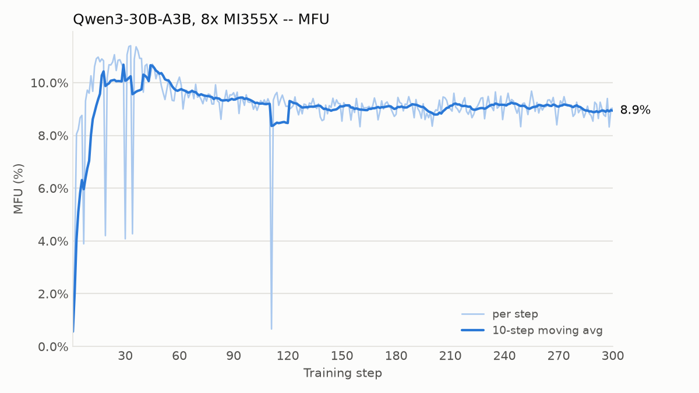
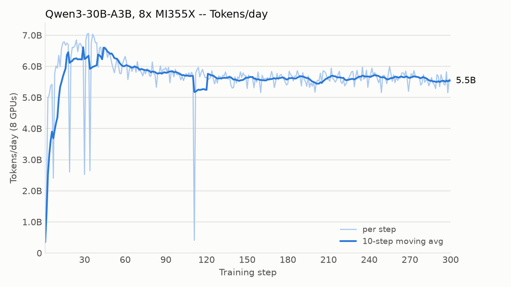

# Qwen3-30B-A3B on 8x AMD Instinct MI355X

Basic single-node pretraining example for Qwen3-30B-A3B (MoE, 128 experts,
top-8, ~3B active params) on C4.

## Setup

- torch `2.16.0.dev20261109+rocm10.0`, torchao nightly (same index as ROCm CI)
- 8x MI355X (288 GiB each), single node
- FSDP over 8 GPUs (EP=1), `torch.compile`, no activation checkpointing,
  CUDA graphs disabled, seq len 4096, 16k tokens per microbatch per GPU

```bash
pip install --pre torch torchao --index-url https://download.pytorch.org/whl/nightly/rocm10.0
pip install -r requirements.txt && pip install -e . --no-deps
python scripts/download_hf_assets.py --repo_id Qwen/Qwen3-30B-A3B --assets tokenizer config

STEPS=300 ./scripts/amd/run_qwen3_30b_a3b_mi355.sh 2>&1 | tee train.log
python scripts/amd/plot_train_metrics.py train.log --num-gpus 8 \
    --out-dir docs/amd/figures --title "Qwen3-30B-A3B, 8x MI355X"
```

## Results (300 steps)

Steady state (steps 11-300): **9.3% MFU**, **~8.3k tokens/s/GPU**,
**~5.7B tokens/day** on 8 GPUs. Peak memory 174 GiB/GPU. Loss 12.36 -> 5.51.




Isolated single-step dips (e.g. step ~111) are one-off stalls; the run
otherwise holds a flat ~9% MFU.

## Expert-parallel sweep (15 steps, same settings)

| EP degree | tokens/s/GPU | MFU |
|-----------|-------------:|----:|
| 1 (FSDP)  | 8,299 | 9.3% |
| 2         | 6,376 | 7.1% |
| 4         | 5,673 | 6.3% |
| 8         | ~7,900 | ~8.8% |

With full activation checkpointing (the config default) and 8k tokens per
microbatch, EP=8 gives ~4k tokens/s/GPU (4.5% MFU).

## Where the time goes

A profiler trace at EP=8 shows the step is communication bound: RCCL kernels
(mostly the MoE all-to-all) take ~50% of GPU kernel time, while the GEMMs are
~10%. A faster grouped GEMM (e.g. Primus-Turbo's) would therefore help little
here; a fused EP dispatcher (DeepEP-style, e.g. Primus-Turbo's) or better
compute/communication overlap is the bigger lever.

## Notes on AMD-AGI/torchtitan-amd

That fork targets an older torchtitan, Python 3.10 and torch 2.9 nightly.
Its bundled Primus-Turbo wheels are cp310 builds against that torch and are
not usable with this stack. The ROCm launch settings (`GPU_MAX_HW_QUEUES=2`,
`PYTORCH_TUNABLEOP_ENABLED=0`, and the multinode PXN settings) were carried
over into `scripts/amd/run_qwen3_30b_a3b_mi355.sh`.
